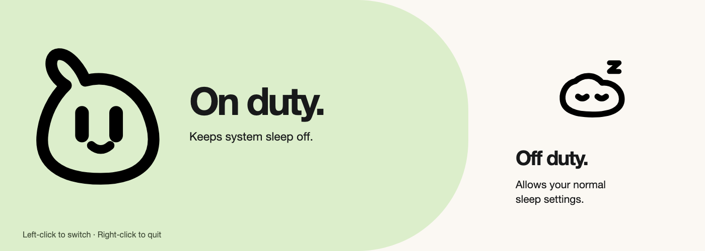

# Wakey

A tiny animated menu-bar companion that keeps your Mac awake with one click.


**[Install from source ↓](#install)** · [How it works](#use) · [Build & contribute](CONTRIBUTING.md)



Wakey is useful when a long-running task needs your Mac to stay awake. Left-click its creature to toggle system sleep prevention. It squishes when awake, breathes with drifting Zs when off, and changes posture between states.

## Install

**Source build · macOS 26+ · Xcode 26+ / Swift 6.2+**

A signed, notarized download is not available yet. Build locally with your own Apple signing identity; the privileged helper cannot work in an unsigned build.

1. Install Xcode, open it once, and select it in **Xcode → Settings → Locations → Command Line Tools**.
2. In **Xcode → Settings → Accounts**, add your Apple account. Under **Manage Certificates**, create an **Apple Development** certificate if you don’t already have one.
3. Clone and build:

   ```bash
   git clone https://github.com/tapandsaveph/wakey.git
   cd wakey
   ./scripts/build.sh
   ditto dist/Wakey.app /Applications/Wakey.app
   open /Applications/Wakey.app
   ```

4. In the System Settings page that opens, enable **Wakey** under **General → Login Items & Extensions → Background App Activity**. Complete the administrator approval.

That approval lets Wakey change the sleep setting without asking for a password on every click. If several signing identities are installed, see [choosing a certificate](CONTRIBUTING.md#signing).

## Use

| Action | Result |
| :-- | :-- |
| Left-click | Toggle sleep prevention |
| Right-click → Quit | Close Wakey |
| Hover | Read the current state or an error |

**Awake creature:** system sleep is prevented. **Sleeping creature:** your normal sleep settings are allowed; the Mac is not immediately put to sleep.

Quitting keeps the current system setting. Switch Wakey off first if you want normal sleep. Other apps and your existing power settings can still keep the Mac awake.


<sub>Development capture. The cover is illustrated brand artwork; the state preview uses the approved creature marks.</sub>

## Under the hood

A native AppKit status item reads `pmset -g`. A small, approved `SMAppService` helper runs exactly one operation: `/usr/bin/pmset -a disablesleep 0|1`.

- Both sides verify the peer’s signing certificate and executable identifier.
- The helper accepts requests only from the active console user.
- The UI reads the system setting back before showing a successful change.
- Animation respects Reduce Motion. The app has no network client, analytics, or stored passwords.

No Dock window, subscription, web runtime, or `sudoers` changes. [Security details](SECURITY.md).

## Remove

1. Switch Wakey off.
2. Run `/Applications/Wakey.app/Contents/MacOS/Wakey --remove-helper`.
3. Right-click its menu-bar icon → **Quit**, then move **Wakey.app** from Applications to Trash.

## Development

```bash
./scripts/check.sh
```

The checks compile both executables, test sleep-state parsing and failure handling, load all 432 animation frames, verify transition routing, and verify the local code signatures. The check build is ad-hoc signed and cannot register the helper.

Tested on Apple Silicon. Intel builds are not yet verified. Background-helper approval and physical sleep behavior require testing on a real Mac; CI cannot approve them.

[Contributing](CONTRIBUTING.md) · [Artwork & visual sources](docs/ASSETS.md) · [MIT license](LICENSE)
